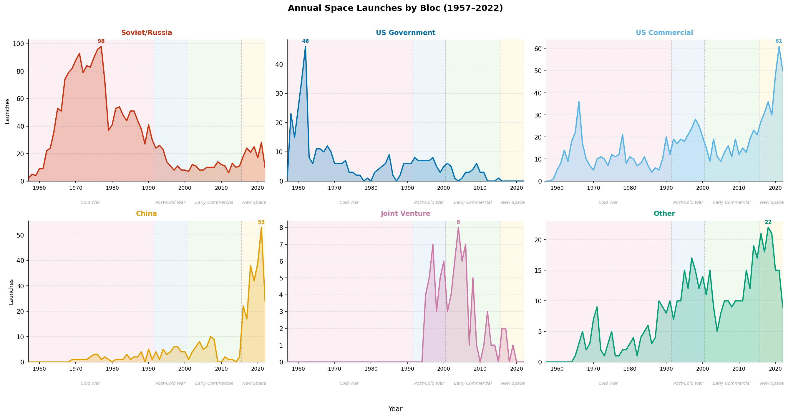
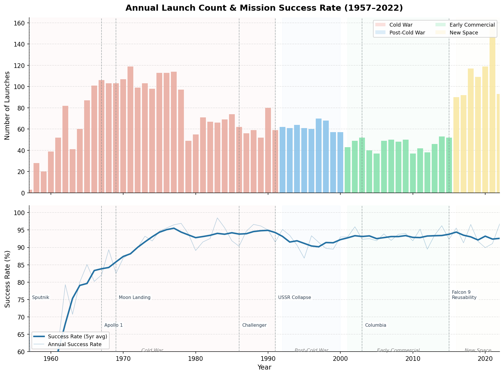
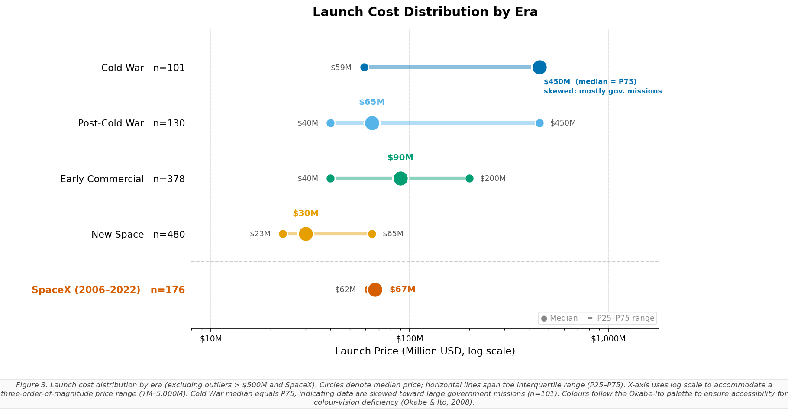
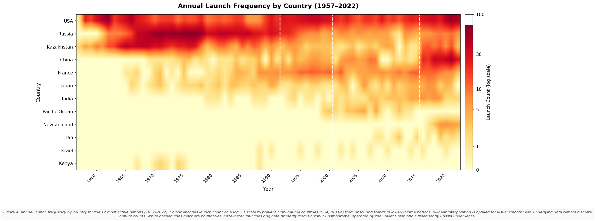
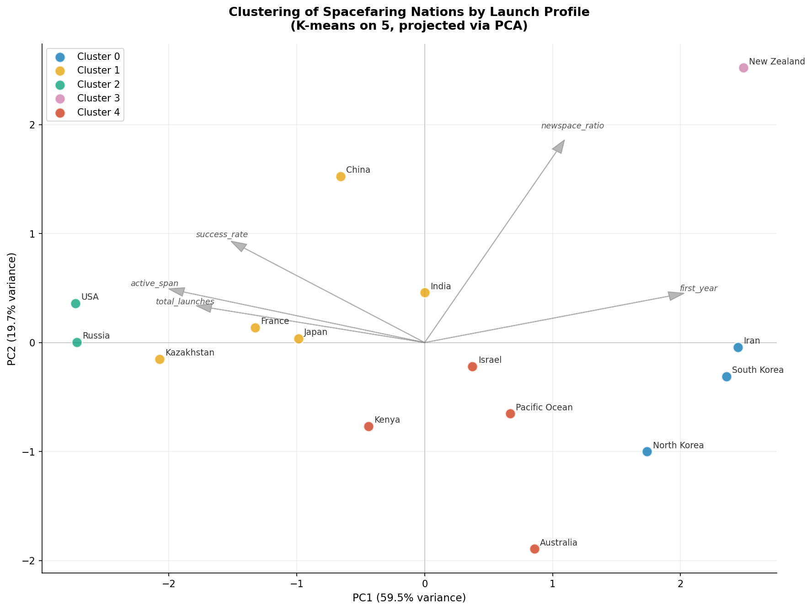

# Space Launches 1957–2022: From Cold War Race to Commercial Space

I analysed 4,630 rocket launches from 1957 to 2022 to see how the drivers of
space launch activity changed over 65 years. The project has two parts: a set
of static charts and statistical tests in Python, and an interactive 3D globe
built with Three.js (plus a PyOpenGL 3D bar chart for comparison). It started
as my major project for COSC3000 (Data Visualisation and Computer Graphics) at
the University of Queensland.

## Summary

The short version is that commercialisation made launches much cheaper without
making them less reliable. Among launches with a recorded price, cost fell by
about 3.8% a year, and the median price dropped from $90M in the early
commercial era (2001–2015) to $30M in the new space era (2016–2022). Over the
same period the success rate stayed above 92%, even as the yearly number of
launches climbed to almost 150 in 2022.

## Data and cleaning

The data is the Space Missions (1957–2022) dataset from Kaggle( https://www.kaggle.com/datasets/saikat026/space-missions). Each row is one
launch, with the company, rocket, launch site, date, mission status and price.
I parsed the dates, turned the price column into numbers (anything that could
not be parsed is left missing), and took the country from the end of the
launch site. Offshore platforms needed manual fixes, for example the Yellow
Sea counts as China and the Barents Sea as Russia.

I then added three fields for the analysis. `Bloc` groups launch providers into
Soviet/Russia, US Government, US Commercial, China, Joint Venture and Other.
`Success` is 1 only when the mission status is "Success". `Era` splits the
timeline into the Cold War (1957–1991), post Cold War (1992–2000), early
commercial (2001–2015) and new space (2016–2022) periods.

## Questions

I set up three hypotheses before making the charts. First, that Cold War
politics drove the early launch peak. Second, that the collapse of the Soviet
Union caused a slump which commercial companies later filled. Third, that
commercialisation lowered costs while keeping the success rate stable.

## What I found

Launches by bloc show the Cold War pattern clearly. The Soviet Union peaked at
98 launches in 1971, well above the US, and after 1991 global launch volume
fell by about 40%. From 2001 onward the gap was filled by US commercial
companies and China. China went from single digits to 53 launches in 2022,
second only to US commercial launches (61, mostly SpaceX).



Reliability improved fast and then held. Between 1957 and 1960 more than 40%
of launches failed, but by the 1970s the success rate was around 95%. The
Challenger and Columbia disasters show up in the failure counts, yet they do
not change the long-term trend, and the rate stays above 92% in the new space
era even though far more rockets are launched.



For cost, I fitted a regression of log price against year (excluding SpaceX
and outliers above $500M). The slope is -0.0168 log10 per year, which works
out to about 3.8% cheaper each year (R² = 0.163, p < 0.0001). A t-test between
the early commercial and new space eras (mean $129.4M vs $54.8M, t = 11.65,
p < 0.0001) shows the drop is not random noise.



The heatmap of 12 countries shows the same story on a map of time: dark red
for the Soviet Union in the 1970s, then China slowly catching up to the US by
the 2020s, and new players like New Zealand appearing only after 2015.



Finally, I clustered the 15 countries with at least 5 launches using K-means
on five standardised features (total launches, success rate, first launch
year, active span and share of launches in the new space era). The silhouette
score was highest at k = 5 (0.38), and a PCA projection keeps 79.3% of the
variance. The clusters separate veteran powers (US, Russia), a mature middle
group (China, France, Japan, India), restricted newcomers (Iran, North Korea,
South Korea) and New Zealand as a pure new space case. The boundaries are
soft, which I read as a finding in itself: today's landscape is more of a
spectrum than the two-camp structure of the Cold War.



## 3D globe

The interactive globe in `globe/index.html` places every launch site on a
textured Earth. Latitude and longitude are converted into spherical
coordinates, disc size encodes the number of launches and colour encodes the
bloc. You can drag to rotate, scroll to zoom, filter by era and bloc, and
hover over a site to see its stats. I chose a globe because a flat map
distorts high latitudes, where several major launch sites are. The PyOpenGL
scripts draw the same data as 3D bars over the eastern and western
hemispheres, mainly to compare a low-level OpenGL pipeline with Three.js.

## Limitations

Only about 27% of launches have a price, and Cold War prices mostly come from
large government programmes, so the cost results apply to launches with a
recorded price rather than every launch. Countries are assigned by launch site
location, which means Baikonur is counted as Kazakhstan even though the Soviet
Union and later Russia ran it. The success field is binary, so partial
failures count as failures.

## Files and how to run

```
data/        cleaned dataset and data dictionary
analysis/    cleaning, statistics and chart scripts
figures/     exported charts
globe/       Three.js globe, PyOpenGL scripts, demos
```

Install the packages with `pip install -r requirements.txt`. To rebuild the
cleaned data, download the raw CSV from Kaggle into `data/space_missions.csv`
and run `python analysis/cleaning.py`. The chart scripts (`fig1.py` to
`fig7.py`) read `data/space_missions_clean.csv` and save into `figures/`, and
`python analysis/result.py` prints the cost statistics. To view the globe,
run `python -m http.server` inside `globe/` and open
`http://localhost:8000`, because the page loads `launch_data.json` with
`fetch`, which does not work from a plain file.
